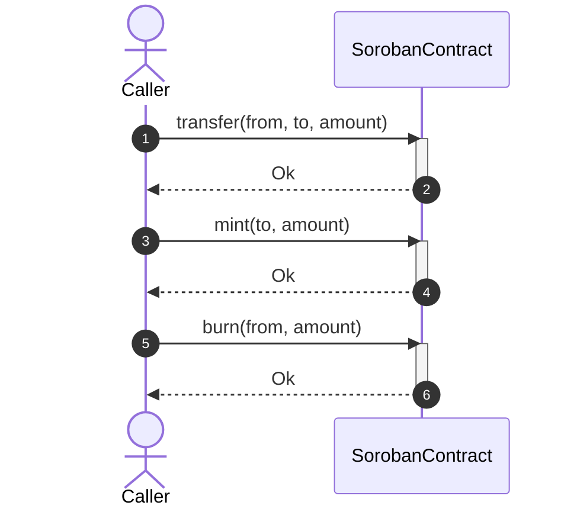
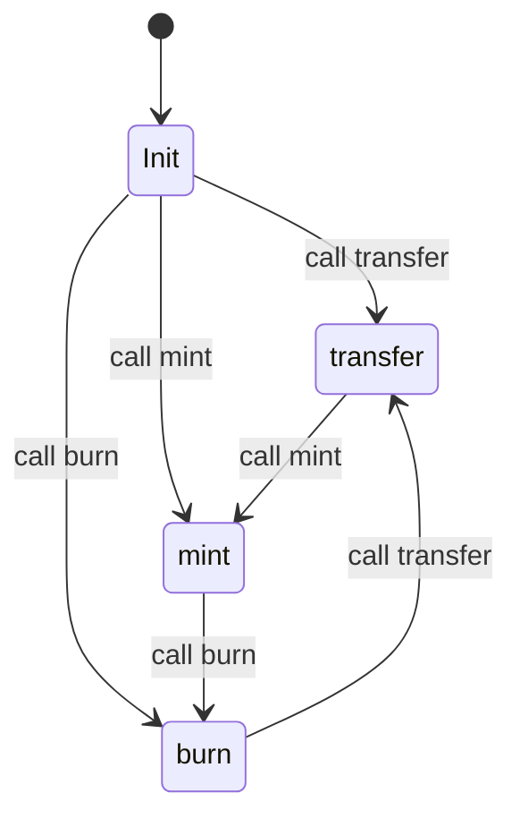

# Temporal Invariants Engine: Architecture, Verification & Limitations

## 1. Executive Summary & Problem Overview

In smart contract auditing for the Stellar and Soroban ecosystem, conventional invariant engines perform **point-in-time snapshot checks** — evaluating source code or single-state memory snapshots to verify whether assertions or regex patterns (e.g. `total_supply == sum(balances)`) appear intact.

However, real-world vulnerabilities and economic exploits on Stellar Soroban are rarely point-in-time bugs; they arise from **temporal property violations** spanning sequences of transactions or multi-step execution paths. Common examples include:
- **Temporary State Desynchronization**: A reentrancy or multi-step workflow where `balances` are credited before `total_supply` is updated, temporarily violating supply-balance equality.
- **Economic Invariant Violations**: Operations such as a 3-step `transfer -> mint -> burn` sequence where net token supply or value changes without appropriate collateralization or authorization, violating closed system conservation of value.
- **Monotonicity Degradation**: Timestamp manipulation, sequence number rollback, or non-increasing nonce tracking.

To resolve these challenges, the scanner introduces a dedicated **Temporal Invariant Engine** (`src/invariants.rs`), which constructs contract call graphs as state transition diagrams and verifies properties across bounded execution paths.

---

## 2. Linear Temporal Logic (LTL) Modalities

The engine classifies all 24 `InvariantRule` variants into five formal temporal modalities inspired by Linear Temporal Logic (LTL):

| Modality | Formal Operator | Description | Representative Rules |
| :--- | :--- | :--- | :--- |
| **`AlwaysHolds`** | $\square P$ (Globally) | The invariant predicate $P$ must evaluate to true in all reachable states along every valid execution sequence. | `TotalSupplyConsistency`, `BalanceNonNegative`, `TransferConservation`, `ConservationOfValue`, `AdminAuthorization` |
| **`EventuallyHolds`** | $\lozenge P$ (Finally) | The invariant predicate $P$ must eventually hold or be restored along all execution trajectories. | `EventStateConsistency` |
| **`NeverViolated`** | $\square \neg P$ (Safety) | The hazardous predicate $P$ must never occur on any reachable state path. | `NoFreeMoney`, `NoNegativeBalances`, `OverflowProtection` |
| **`MonotonicIncrease`** | $\Delta \ge 0$ | The monitored variable must never strictly decrease across any state transition. | `MintSupplyIncrease`, `TimestampMonotonicity`, `SequenceNumberIntegrity` |
| **`MonotonicDecrease`** | $\Delta \le 0$ | The monitored variable must never strictly increase across any state transition. | `BurnSupplyDecrease` |

---

## 3. State Transition Graph & Sequence Diagram Generation

The engine extracts the contract's public function call graph and represents it as a directed state machine:

### 3.1 Components
- **`StateNode`**: Encapsulates a contract state reached after executing a specific public function, tracking state variable reads and writes.
- **`StateTransition`**: Directed edge representing an invocation $S_i \xrightarrow{\text{call } F} S_j$, recording:
  - Caller authorization requirements (`requires_auth`).
  - Preconditions / require guards.
  - State deltas (`StateDelta`: target, operation, value effect $\pm 1, 0$).
- **`SequenceDiagram`**: Container graph with entry points (`Init`), nodes, and transitions.

### 3.2 Visual Diagrams

The engine generates Mermaid-compatible sequence and state transition diagrams:





---

## 4. Path Exploration & Depth Control

### 4.1 Traversal Algorithm
The engine uses bounded Depth-First Search (`dfs_paths`) starting from the initial state (`Init`) through outgoing transitions. 

Path exploration is controlled by the **`max_depth`** parameter (default: 5 transitions):
- Depth 1: Single function invocations (`[transfer]`, `[mint]`, `[burn]`).
- Depth 2: Two-step transaction compositions (`[transfer, mint]`, `[mint, burn]`, etc.).
- Depth 3: Three-step execution chains (`[transfer, mint, burn]`).
- Up to `max_depth`.

### 4.2 CLI Integration
The `--temporal-depth` flag is available on both `stellar-scanner scan` and `stellar-scanner invariants`:

```bash
# Run comprehensive scan with custom temporal exploration depth
stellar-scanner scan --temporal-depth 6 --path ./contracts

# Run invariant scan with temporal depth
stellar-scanner invariants --temporal-depth 4 --path ./contracts/token
```

---

## 5. Conformance Verification: `transfer -> mint -> burn`

To verify the engine's precision, conformance testing is established for contracts exhibiting value fluctuations:

```rust
pub fn transfer(from: Address, to: Address, amount: i128) {
    balance -= amount;
    balance += amount;
}

pub fn mint(to: Address, amount: i128) {
    require_auth(&admin);
    total_supply += amount;
    balance += amount;
}

pub fn burn(from: Address, amount: i128) {
    require_auth(&from);
    total_supply -= amount;
    balance -= amount;
}
```

### Analysis Outcome:
When evaluated against `InvariantRule::ConservationOfValue`:
1. The engine extracts the 3 public functions and forms the state transition graph.
2. The 3-step sequence `["transfer", "mint", "burn"]` is explored.
3. At step 2 (`mint`), the net value effect on token supply is $+1$ (unbacked inflation).
4. `ConservationOfValue.check_path()` flags a `TemporalViolation`:
   - **Rule**: `InvariantRule::ConservationOfValue`
   - **Temporal Type**: `TemporalInvariant::AlwaysHolds`
   - **Path**: `["transfer", "mint", "burn"]`
   - **Fault Step**: Step 2 (`mint`)
   - **Detail**: `Value delta was 1, breaking closed value conservation in execution sequence`

Conversely, contracts containing only closed transfer operations preserve conservation of value across all paths and pass with `Ok(())`.

---

## 6. Known Limitations & Trade-offs

### 6.1 Path Explosion ($O(b^d)$)
In a smart contract with $b$ public functions, the number of distinct execution paths of length $d$ grows exponentially:
$$N(d) = \sum_{k=1}^d b^k \approx O(b^d)$$

For example:
- $b = 3, d = 5 \implies 3^5 = 243$ paths (instantaneous, $< 1\text{ms}$).
- $b = 10, d = 5 \implies 10^5 = 100,000$ paths (requires bounding).
- $b = 20, d = 10 \implies 20^{10} \approx 1.02 \times 10^{13}$ paths (intractable without pruning).

**Mitigation in Engine**:
- Default depth limit: 5 transitions.
- Hard path exploration ceiling: `MAX_TOTAL_PATHS = 4096`.
- Violation early termination: caps maximum recorded violations to prevent memory exhaustion.

### 6.2 State Space Coverage
Static call-graph abstraction provides structural over-approximation:
- **Unbounded Loops**: Reentrant loops or unbounded loops are abstracted into single transition cycles.
- **Symbolic Arguments**: Abstracted into sign-effect domains ($\pm 1, 0$) rather than concrete SMT solving.
- **External Contract Calls**: Cross-contract invocations (`env.invoke_contract`) are treated as opaque external transitions unless paired with multi-contract manifests.

### 6.3 Recommended Best Practices
1. **Target Critical Subgraphs**: Audit token economics and access-control modules using depth 3 to 7.
2. **Combine with Fuzzing**: Use the Temporal Invariant Engine for static path verification and Differential Fuzzing (`time_travel_debugger`, `differential_fuzzing`) for concrete runtime state exploration.
3. **Continuous CI Integration**: Run `--temporal-depth 5` in pre-merge CI pipelines for deterministic, regression-free guarantees.
